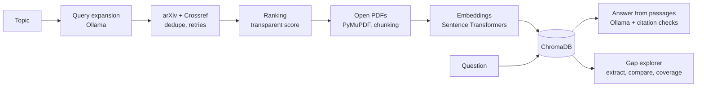

# ResearchLens AI

A local research assistant that finds papers and web articles on a topic, ranks them, answers questions with **page-level citations to the papers plus a clearly separated general-knowledge answer**, suggests the best papers for each question, and points out gaps in the collected research without claiming gaps in the whole field.

Runs entirely on a laptop with free tools: no paid APIs and no cloud.


## What it does

1. **Discover**: you enter a topic; a local LLM expands it into search queries for **arXiv** and **Crossref**. Results are deduplicated, with rate limits and retries.
2. **Rank**: papers get a transparent score (relevance, recency, open PDF, abstract), and every score can be broken down. An optional LLM "second opinion" reads full-text passages.
3. **Index**: the best open-access PDFs, plus a few web articles, are downloaded, split into page-aware chunks, embedded and stored in a local vector database. Web pages are read with Trafilatura only when the site's `robots.txt` allows it; logins and paywalls are skipped. You can also paste any article URL.
4. **Ask**: each answer has three parts:
   - 📄 **From your papers**: generated only from retrieved passages, with numbered citations linking to the exact PDF page; missing, invalid or unsupported citations get a warning.
   - 🧠 **Beyond your papers**: a separate answer from the model's general knowledge, labelled as unverified (can be turned off).
   - 📚 **Best sources for this question**: from your collection, plus new arXiv papers and 🌐 web articles you can add with one click.
5. **Explore gaps**: per-paper methods, datasets, metrics and limitations (verified against the text), coverage of expected sub-topics, and possible disagreements between papers.

### How it avoids overclaiming gaps

A sub-topic missing from the collection is checked in three steps, and labelled accordingly:

| Label | Meaning |
|---|---|
| ✅ covered | 2+ collected papers mention it |
| ⚠️ thin | Only 1 collected paper mentions it |
| 📚 collection gap | Not in the collection, but on-topic papers exist on arXiv (one click adds them) |
| ❓ possibly underexplored | Not found in the collection or a quick on-topic search; a lead to verify, never "nobody has studied this" |

## Architecture



Two phases: **ingestion** (once per topic: discover → rank → download → chunk → embed → store) and **query** (every question: embed → retrieve 8 chunks → answer → verify citations).

| Component | Tool | Why |
|---|---|---|
| UI | Streamlit | Python-only web UI |
| Paper search | arXiv API, Crossref API | Free; arXiv provides open PDFs |
| Web search | Tavily (optional free-tier key), else Wikipedia + Hacker News APIs | Official APIs, no search-engine scraping |
| Web page text | Trafilatura | Extracts article text, drops menus and ads |
| PDF text | PyMuPDF | Fast, keeps page numbers |
| Embeddings | `all-MiniLM-L6-v2` | Small and local (~90 MB) |
| Vector DB | ChromaDB (local, telemetry off) | Simple persistent store |
| LLM | Ollama + `qwen3:1.7b` | Free, private, fits in 8 GB RAM |

## Evaluation

Measured with `python -m eval.run_eval` on a small labelled set (12 answerable + 4 unanswerable questions; 48 papers with relevance labels). Full report: [`eval/results_k8.md`](eval/results_k8.md).

| Metric | Result |
|---|---|
| Gold paper retrieved (hit@8) | 100% |
| Answer passage retrieved (evidence recall@8) | 67% |
| Answer contains the expected fact | 67% |
| Citations pointing to the right paper | 100% |
| Invalid citations | 0 |
| Unanswerable questions refused or warned | 100% |
| Paper ranking nDCG@10 | 0.67 |

Evaluation changed three design decisions: a relevance-scaling tweak that looked better by eye was **reverted** (nDCG 0.50 vs 0.67); retrieval was raised from 5 to 8 chunks (correctness 58% → 67%); and a sentence-level support check was added after a hallucinated answer passed the citation check.

> The test sets are small and were labelled with AI assistance, so treat the numbers as indicative.

**Tests:** 93 unit tests (`pytest -q`) cover the pipeline and 24 failure cases (duplicates, missing or scanned PDFs, hallucinated citations, services down, and others). See [`eval/failure_cases.md`](eval/failure_cases.md).

## Setup

Requirements: Python 3.11+ (tested on 3.14), [Ollama](https://ollama.com), ~2 GB free RAM for the model.

```bash
git clone https://github.com/<your-username>/researchlens.git
cd researchlens
python3 -m venv .venv
source .venv/bin/activate
pip install -r requirements.txt
cp .env.example .env            # set CONTACT_EMAIL; optionally TAVILY_API_KEY

ollama pull qwen3:1.7b
ollama serve                    # in a separate terminal
streamlit run app.py
```

The first run downloads the embedding model (~90 MB).

```bash
pytest -q                       # unit tests, no network or Ollama needed
python -m eval.run_eval         # evaluation, needs Ollama and indexed papers
```

## Example

1. Topic: `RAG evaluation techniques for agentic AI systems`, max PDFs 8 → about 50 papers found, 8 indexed (~1–2 min).
2. Ask: *"Which DSPy optimizers did RAGalyst use to refine its metric prompts?"* → "RAGalyst used the COPRO and MIPROv2 optimizers to refine its metric prompts [2], and also applied the LabeledFewShot optimizer…", with each citation linking to the PDF page.
3. Open **Research gaps** → *Analyse gaps* → e.g. "performance metrics for agentic systems: ⚠️ thin, 3 on-topic arXiv papers to add".


## Project structure

```
app.py                  Streamlit UI
src/discovery/          arXiv, Crossref, query expansion, dedupe, discover()
src/processing/         PDF download, text extraction, chunking
src/web/                web search (Tavily / Wikipedia / Hacker News), robots-aware page reading
src/retrieval/          embeddings, ChromaDB store
src/rag/                cited answers + checks, research agent (general knowledge + paper suggestions)
src/ranking/            baseline score, optional LLM judge
src/gaps/               extraction, comparison, coverage, disagreements
src/evaluation/         metrics
eval/                   labelled test sets, evaluation runner, reports
tests/                  pytest suite
```

## Limitations

- Small local model (1.7B): some answers are partial or wrong (67% correctness on the cited part), general-knowledge answers are not checked and may be outdated, and the LLM paper judge is too lenient to rely on, so it is optional and labelled experimental.
- Only open-access arXiv PDFs and publicly readable web pages are used; Crossref papers are metadata-only. Paywalls and logins are never bypassed. Pages that need JavaScript to show text are skipped.
- Without a Tavily key, web results come from Wikipedia and Hacker News and are often only loosely related. Web pages are not peer-reviewed.
- No OCR: scanned PDFs are reported, not read. Appendices after the references are skipped.
- The faithfulness check is word overlap, so it gives some false alarms and is not a true entailment check.
- All topics share one vector collection.
- Gap labels rely on one quick arXiv search, so "possibly underexplored" is a lead, not a finding.

## License

MIT
